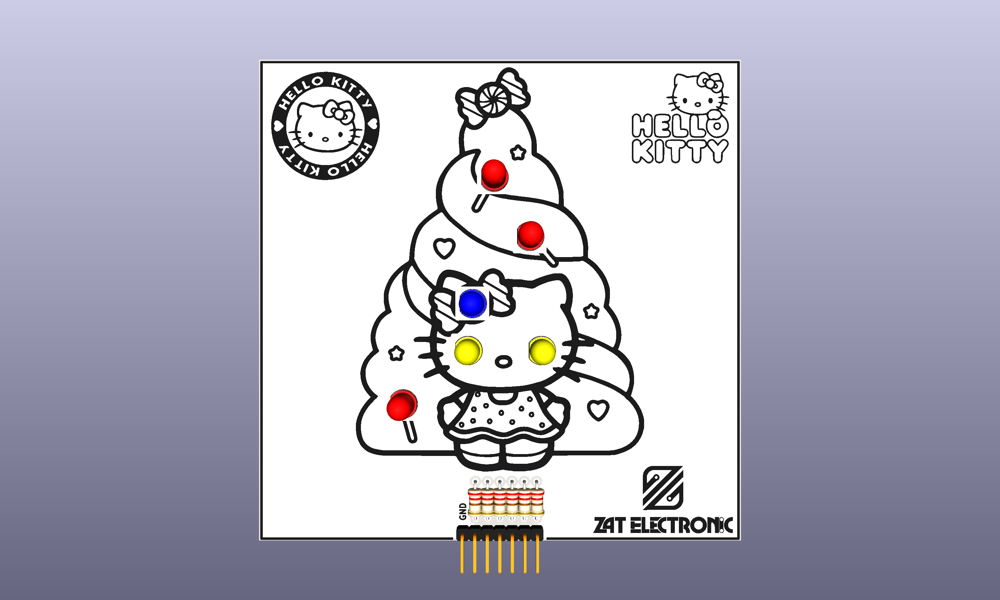
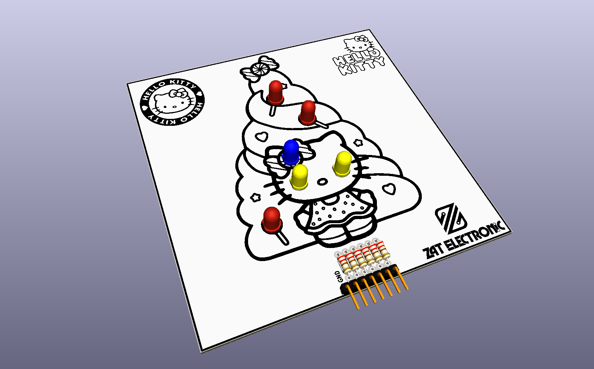

# HELLO KITTY — placa de arte com 6 LEDs

Placa de arte Hello Kitty desenhada na serigrafia, com **6 LEDs coloridos** de 5 mm (vermelho, azul e amarelo) ligados a uma **barra de 7 pinos 90°** na borda da placa.

<p align="center">
  
  
</p>

## Funcionalidades

- ✅ **Barra de pinos 1×07 90°** (J1) na borda — 1 GND + 6 canais
- ✅ **6 LEDs 5 mm** THT (D1–D6): D1 vermelho, D2 azul, D3 amarelo, D4 vermelho, D5 vermelho, D6 amarelo
- ✅ **6 resistores 220 Ω 1/4 W** axiais (R1–R6), um por LED
- ✅ Liga em qualquer microcontrolador (Arduino, ESP32, Pico) com GND comum
- ✅ **Arte na serigrafia** recortada em volta de cada LED (nada de tinta sobre pad)
- ✅ Placa **100 × 100 mm**, 2 camadas, plano de GND nas duas faces

## Ligação dos LEDs

| LED | Cor | Resistor | Pino J1 / sinal | Corrente @ 5 V |
|---|---|---|---|---|
| D1 | vermelho | R1 220 Ω | J1.2 · LED1 | ≈ 13,6 mA |
| D2 | azul | R2 220 Ω | J1.3 · LED2 | ≈ 9,1 mA |
| D3 | amarelo | R3 220 Ω | J1.4 · LED3 | ≈ 13,6 mA |
| D4 | vermelho | R4 220 Ω | J1.5 · LED4 | ≈ 13,6 mA |
| D5 | vermelho | R5 220 Ω | J1.6 · LED5 | ≈ 13,6 mA |
| D6 | amarelo | R6 220 Ω | J1.7 · LED6 | ≈ 13,6 mA |

Cada canal: **pino → 220 Ω → LED → GND** (nível alto acende). Todos acesos ≈ **77 mA**.

| J1 | Sinal |
|---|---|
| 1 | GND |
| 2 | LED1 (D1) |
| 3 | LED2 (D2) |
| 4 | LED3 (D3) |
| 5 | LED4 (D4) |
| 6 | LED5 (D5) |
| 7 | LED6 (D6) |

> Em 3,3 V (ESP32 / Pico) os LEDs vermelho/amarelo ficam com ≈ 6 mA e o azul fica bem fraco (≈ 1 mA).

## Diagrama de blocos

```
┌──────────────────────┐   LED1 … LED6      ┌──────────────────────────┐
│  J1 barra 1×07 90°   │ ─────────────────► │ 6 × [220 Ω → LED 5 mm]   │
│  1 GND · 2–7 canais  │ ◄──────── GND ──── │  R1–R6       D1–D6       │
└──────────────────────┘                    └──────────────────────────┘
```

## Firmware

`firmware/HELLO_KITTY/HELLO_KITTY.ino` — exemplo simples (corrida, pisca alternado e aleatório). Ligação: **Arduino D8 … D13 → J1 pinos 2 … 7**, GND → J1 pino 1.

## Esquemático (KiCad 10)

| Pág. | Folha | Conteúdo |
|---|---|---|
| 1 | Capa (A2) | blocos, mapa dos LEDs na placa, vista 3D |
| 2 | LEDS | D1–D6 + R1–R6 |
| 3 | CONN | J1 (barra 1×07 90°) + PWR_FLAG do GND |

## Lista de materiais

| Ref. | Qtd | Valor | Footprint |
|---|---|---|---|
| D1,D4,D5 | 3 | LED 5 mm vermelho | ZAT_LED:LED_D5.0mm_Red |
| D2 | 1 | LED 5 mm azul | ZAT_LED:LED_D5.0mm_Blue |
| D3,D6 | 2 | LED 5 mm amarelo | ZAT_LED:LED_D5.0mm_Yellow |
| J1 | 1 | Barra de pinos 1×07 90° | ZAT_Connector:PinHeader_1x07_P2.54mm_RightAngle_EdgeMount |
| R1–R6 | 6 | 220 Ω 1/4 W | ZAT_Resistor_THT:R_Axial_DIN0204_L3.6mm_D1.6mm_P7.62mm_Horizontal_220R |

## Arquivos

- `HELLO_KITTY.kicad_pro` — projeto KiCad 10 (bibliotecas globais KiCad + ZAT, sem pasta lib)
- `Zat_TitleBlock.kicad_wks` — moldura Zat Electronic
- `packages3D/` — modelos 3D usados na vista 3D

## Licença / autor

Projeto **Zat Electronic** — Kenneth Zat · Osasco/SP · hardware aberto.

*Revisão R01 — 2026-11-12 — KiCad 10.*
